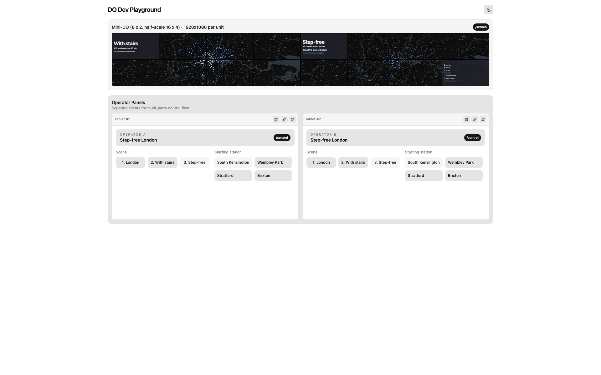

# Step-free London: who can get where?

How much smaller does London get if you can't use stairs? This repo is a submission for
Imperial's Data for Humanity Internship: a demo for the Data Observatory (DO), a wall of 16 × 4
screens, built from Transport for London's open data. It comes in two halves:

| Half                                                 | What it is                                                                    |
| ---------------------------------------------------- | ----------------------------------------------------------------------------- |
| **1. [Poster](poster/README.md)** (`poster/`)        | A poster for the DO built in Vizzy Studio, plus the Python analysis behind it |
| **2. [Playground](#2-playground)** (`apps/website/`) | An interactive wall app built on the DSI Developer Playground                 |

## Key findings

Fastest journeys from South Kensington, Imperial's station, to every other station on London's
rail network, departing Tuesday 24 November 2026 at 09:00, from the TfL Journey Planner API:

- **South Kensington to Bank takes 22 minutes, or 54 minutes step-free.** South Kensington has
  no lifts, so every step-free journey from it starts with a bus.
- **Within 45 minutes, step-free travellers reach 93 stations; with stairs, 418** (22%).
- **A typical journey takes 26 minutes longer step-free.**

From three other starting stations the step-free traveller keeps more of their reach: Wembley
Park 43%, Brixton 44%, Stratford 61%. Step-free journeys count a station as reached at its
street entrance and assume every lift works, so the real difference is larger. Method and
caveats: [poster/analysis/README.md](poster/analysis/README.md).

## 1. Poster

[`poster/`](poster/README.md) holds everything for the Vizzy Studio poster:

| Path                                          | Contents                                                                                                   |
| --------------------------------------------- | ---------------------------------------------------------------------------------------------------------- |
| [poster/README.md](poster/README.md)          | How to build the poster: sections, text, figure sizes, colours                                             |
| [poster/NARRATIVE.md](poster/NARRATIVE.md)    | The story: key message, audience, takeaway                                                                 |
| [poster/figures/](poster/figures/)            | The five figures, as SVG and PNG                                                                           |
| [poster/analysis/](poster/analysis/README.md) | Python pipeline: fetches journeys, computes reach, draws the figures, and exports the playground's dataset |

To regenerate everything you need Python 3.12 and a free TfL API key; see
[poster/analysis/README.md](poster/analysis/README.md).

## 2. Playground

The same story as a live, operator-driven wall app in [`apps/website/`](apps/website/), built
on the DSI Developer Playground.

- **The wall splits in two:** columns 0–7 map travel times with stairs, columns 8–15 step-free.
  Each half is one continuous map of London across its screens.
- **An operator tablet (`/control`) drives the story:** pick a starting station (South
  Kensington, Wembley Park, Stratford, Brixton) and step through three scenes: _London_ (the
  network, uncoloured), _With stairs_ (left half lights up), _Step-free_ (right half lights up
  alongside, with the share of reach kept).
- **Text sits on whole screens, never across a bezel,** at 20% of screen height for the
  headline. Colour changes fade slowly; nothing flashes.

Run it with Node 22.12 or later: `pnpm install`, `pnpm dev`, then open
<http://localhost:5780>. The home page simulates the wall at half scale (8 × 2 screens, the same
7:1 shape as the real 16 × 4) with two tablets. On the real wall each screen loads
`/screen?c=<column>&r=<row>`; without `cols`/`rows` parameters, screens assume the full 16 × 4
wall. `pnpm run ready` runs format, lint, tests and build.

How it follows the playground's [best practices](BEST_PRACTICES.md):

- Tablets send small, complete commands (`control/origin`, `control/scene`), never "next". The
  bus validates them, forwards only the validated fields, and keeps the current state for the
  `hello` snapshot, so a screen that reloads mid-story rejoins in step.
- Screens validate every message and the dataset before using them; tests cover this.
- Everything a screen draws is computed from the shared state, the dataset and its own
  position, so all screens agree without talking to each other.

Known issue: the starter's luma.gl 9.2.6 throws on startup in the deck.gl renderer ("reading
'maxTextureDimension2D'"), so screens use the MapLibre renderer by default. The deck.gl path is
still available with `?renderer=deck` for testing.

## Credits

- Analysis, poster and playground app by Zak Nabi, Imperial College London.
- Powered by the Transport for London Journey Planner API. Data provided by Transport for London.
- Built on the [Data Observatory Developer Playground](https://github.com/dsi-icl/do-starter-playground)
  by Imperial's Data Science Institute, licensed under Apache 2.0 (see [LICENSE](LICENSE)). Its
  original example (city buttons, arcs, zoom slider) was replaced by the step-free story; the
  rest of the starter (simulator, WebSocket bus, engines, tooling, [BEST_PRACTICES.md](BEST_PRACTICES.md))
  is kept.
- Map tiles © OpenStreetMap contributors © CARTO.
