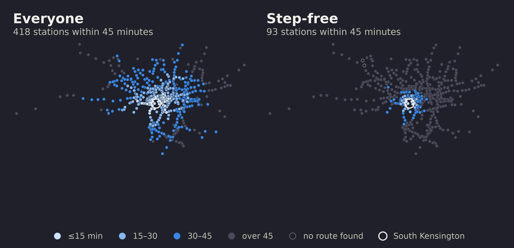

# Step-free London: who can get where?

How much smaller does London get if you can't use stairs? This repo holds the data analysis
behind a poster for Imperial's Data Observatory,
built in Vizzy Studio for the Data for Humanity Internship application.



## Key findings

Journeys from four stations to every station on London's rail network, departing Tuesday
24 November 2026 at 09:00, from the TfL Journey Planner API:

| From             | Stations within 45 min: everyone | Step-free | Share of reach kept |
| ---------------- | -------------------------------- | --------- | ------------------- |
| South Kensington | 418                              | 93        | 22%                 |
| Wembley Park     | 280                              | 119       | 43%                 |
| Brixton          | 397                              | 174       | 44%                 |
| Stratford        | 366                              | 224       | 61%                 |

- From Imperial's own station, **South Kensington to Bank takes 22 minutes, or 54 minutes
  step-free**.
- The typical journey from South Kensington takes **26 minutes longer** step-free.
- **Where you start matters**: of the four origins tested, Imperial's station loses the most.

These are planned journeys, and for stations without step-free access the step-free route ends at
the street entrance, so the real gap is larger. Full method and caveats:
[scripts/step_free/README.md](scripts/step_free/README.md).

## What's in this repo

| Path                                                   | Contents                                                                    |
| ------------------------------------------------------ | --------------------------------------------------------------------------- |
| [docs/NARRATIVE.md](docs/NARRATIVE.md)                 | The story: key message, audience, takeaway and the poster's section layout. |
| [scripts/step_free/](scripts/step_free/README.md)      | Python pipeline: fetches journeys, computes reach, draws the figures.       |
| [scripts/step_free/output/](scripts/step_free/output/) | Results (`summary.json`, per-station times) and wall-ready SVG/PNG figures. |
| `apps/website/`                                        | The DSI Developer Playground starter app, unmodified.                       |

## Reproduce the analysis

You need Python 3.12 and a free TfL API key from <https://api-portal.tfl.gov.uk/>, saved in
`.env.local` at the repo root as `TFL_APP_KEY=...`.

```bash
pip install -r scripts/step_free/requirements.txt
python scripts/step_free/fetch_journeys.py      # ~4,800 API calls, ~15 minutes, cached locally
cd scripts/step_free && python analyse.py       # writes output/
```

## Credits

- Analysis and poster by Zak Nabi, Imperial College London.
- Powered by the Transport for London Journey Planner API. Data provided by Transport for London.
- Built on the [Data Observatory Developer Playground](https://github.com/dsi-icl/do-starter-playground)
  by Imperial's Data Science Institute, licensed under Apache 2.0 (see [LICENSE](LICENSE)). To run
  the starter app: `pnpm install`, then `pnpm dev`, and open <http://localhost:5780>.
